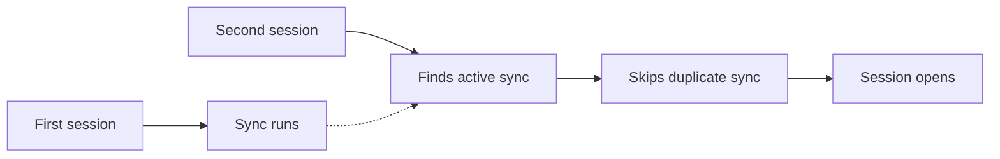
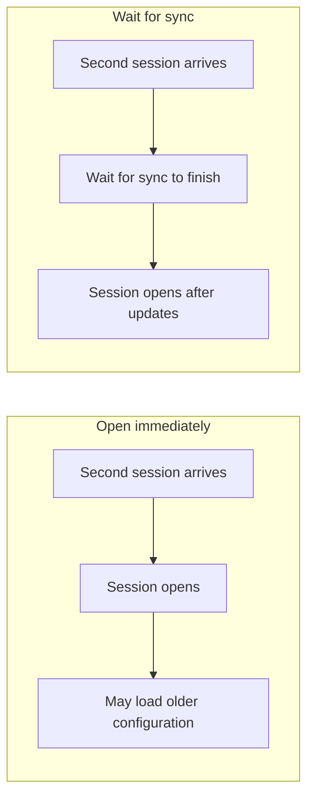

# Interrogate

Lead the design conversation as an architect. Give the user enough context to make informed decisions about the plan and its implementation.

Load [asd-ste100](../asd-ste100/SKILL.md) before the first round. Apply it to the questions, explanations, and final plan.

## Establish the design

Read the relevant project files and prior conversation before asking questions. Investigate facts with available tools. Cite inspected sources for project behavior.

Start an unclear idea with a concrete situation or example. Establish the goal, success criteria, and constraints before asking dependent implementation questions.

Propose coherent designs and explain how they work. Identify gaps, conflicts, and implicit decisions. Bring meaningful design choices to the user with advice.

Cover these areas when they affect the intended result:

- Goals, scope, and user behavior.
- Architecture, interfaces, data, dependencies, and constraints.
- Failure handling, delivery, and verification.

Handle wording, formatting, and routine mechanical details autonomously. Keep accepted decisions, agent proposals, delegated details, and unresolved choices distinct.

## Explain each decision before asking

Present a **decision brief in chat** before each question. Assume the user does not remember the project context.

Use these parts in this order:

1. **How it works today.** Explain the relevant behavior and mechanism. Show a concrete situation and its user-visible result. Cite the evidence. For new work, explain the starting point and known constraints.
2. **What we need to decide.** Explain the open choice, why it matters, and what it affects.
3. **Alternatives.** Explain how each viable approach works, including its benefits, costs, and practical consequences. Use a table when it helps comparison.
4. **My recommendation.** Describe the proposed design and why it fits. Explain relevant established practice and its applicability. State assumptions or uncertainty that could change the recommendation.
5. **Question.** Ask for the specific decision through the available question tool. Use numbered questions in chat when no tool exists.

Give a full comparison before asking the user to choose. Match the detail to the decision. Explain unfamiliar mechanisms before comparing alternatives.

Write in plain language and define unfamiliar terms. Keep sentences short without removing context the user needs. Do not impose a sentence limit on the whole explanation.

A table or tool menu alone is insufficient context. Before asking, check whether the brief lets the user explain the choices and their consequences.

Distinguish verified facts, hypothetical examples, proposals, and assumptions. State unknown causes or frequency explicitly. Explain recommendations that depend on current external guidance with relevant sources.

## Explain visually

Use diagrams as a primary explanation for behavior, structure, timing, and layout. Add short captions and supporting reasoning.

Use multiple diagrams for one question when each explains another part of the decision. There is no fixed diagram count.

For example, one question can use:

- A flow of the current behavior.
- A comparison of the alternative designs.
- A timeline of their user-visible consequences.

Place each diagram beside the explanation it supports, before the question tool. Label current behavior and proposed behavior clearly. Keep names consistent across diagrams.

Use flows for behavior, trees for ownership, timelines for timing, and layouts for screen arrangements. Compare alternatives side by side when readable.

Use Mermaid when the harness supports rendered diagrams. Otherwise, use aligned plain-text diagrams in fenced code blocks. Check labels, connections, and readability before sending.

Split a crowded diagram into smaller diagrams. Avoid decoration and repeated pictures that add no understanding. Do not force a diagram onto an abstract choice it cannot explain.

## Ask in small rounds

Ask up to three related, independent questions per round. Give every question its own decision brief. Present all briefs before opening the question tool.

Ask only questions with known facts and settled prerequisite decisions. Keep dependent questions for later rounds. Adjust the remaining questions after each answer.

Keep tool options short and consistent with the brief. Put the recommendation first. Respect the tool's option limit. Accept the user's own answer or an explicit deferral.

Do not repeat the full explanation inside the tool. Do not reserve an option for simplification. In plain chat, invite numbered answers such as `1A, 2B`.

Preserve answers to the other questions when a response is partial. Clarify ambiguous or contradictory answers before asking dependent questions. Do not treat silence or a request for explanation as acceptance.

When the user needs help, address the specific confusion first. Explain the mechanism another way or use another diagram or concrete example. Then ask the unresolved question again.

Do not silently choose meaningful implementation details. Let the user decide, explicitly delegate, or defer them. Revisit accepted decisions only after new evidence or a user correction.

## Resolve unknowns

Distinguish unknowns that need research, conversation, or a concrete artifact. Investigate discoverable facts before asking questions that depend on them.

When a quick experiment can answer a factual question, use existing authorization to run it. Keep scratch work isolated. Explain what you tested, what you found, and how the result affects the recommendation.

When words cannot resolve a choice, propose a rough artifact the user can inspect. Examples include a flow, layout, outline, or prototype.

Keep research, experiments, delegation, and artifacts within the active task's authorization. Ask for additional authorization only when needed. Remove temporary resources after recording and checking their results.

## Develop the plan together

Briefly connect each new round to the relevant accepted decisions. Restore the context needed for the next choices.

Show each settled area as a short section of the developing plan. Let the user correct it before building dependent decisions on it.

Finish when meaningful decisions have answers, explicit delegation, or explicit deferrals. End with one consolidated plan. Include the goal, chosen behavior, architecture, key implementation details, and acceptance checks where relevant. Record delegated details, assumptions, explicit deferrals, and remaining unknowns.

Check shared understanding through the question tool when available. Revise affected sections after corrections. Identify deferred decisions that still block implementation.

Invoking this skill alone authorizes a design conversation. Use existing authorization for implementation or saved artifacts. Do not create files, tickets, commits, or published content without that authorization.

## Example decision brief

This example describes a hypothetical sync service.

**How it works today**

Starting a session starts background sync. A second session skips its sync when another sync is running.

**What we need to decide**

Should opening the second session depend on that sync finishing? This affects startup speed and which configuration the session can load.

**Alternatives**

Opening immediately keeps startup responsive. The session may load older configuration.

Waiting lets updates finish before configuration loads. A slow download delays startup.

**My recommendation**

Open immediately because this service treats sync as background maintenance. I would recommend waiting if configuration freshness were a requirement.

**Question tool**

Should the second session open immediately or wait for sync?

- **Open immediately (recommended):** Keep startup responsive, with potentially older configuration.
- **Wait for sync:** Let updates finish before opening, with a possible startup delay.
